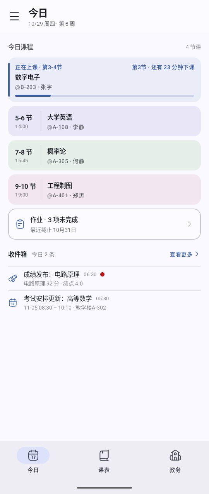
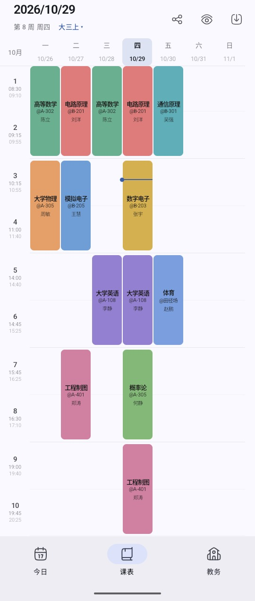
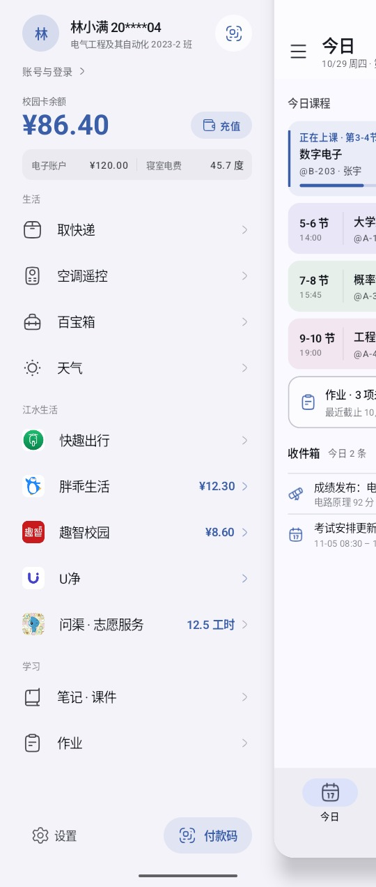

<p align="center">
  
</p>

<h1 align="center">JUWPHub</h1>

<p align="center">
  江西水利电力大学校园生活 App —— 从教务一键导入课表，查询成绩与考试安排；顺手把学生每天要开的那些应用、网页和小程序收进一个应用里。免费、无广告、无内购。
</p>

<p align="center">
  <a href="https://github.com/Inonvation/JUWPHub/releases/latest"></a>
  <a href="#-下载与安装"></a>
  <a href="LICENSE"></a>
</p>

<p align="center">
  <a href="screenshots/today.jpg"></a>
  <a href="screenshots/week.jpg"></a>
  <a href="screenshots/drawer.jpg"></a>
  <br>
  <sub>今日 · 课表 · 左侧栏 —— 截图数据为示例，非真实账号</sub>
</p>

> **非学校官方应用**，学生自用学习项目，详见文末[免责声明](#-免责声明)。

> [!IMPORTANT]
> **JUWPHub 永远免费开源。** 如果你是在任何地方「花钱买到」的，说明你被骗了，请立即退款。任何收费版本均为二次打包的诈骗版本，与本项目无关。

## ✨ 功能一览

- **课表** — 教务一键导入（理论课 / 实验课）、教材、调课检测、上课提醒、桌面小组件、日历同步
- **成绩 · 考试 · 学业** — 成绩与绩点、出分 / 考试提醒、培养方案、实习基地、盖章成绩单
- **问渠 · 志愿服务** — 志愿活动报名与取消、总工时与班级工时、新活动提醒、抢活动蹲点
- **一卡通** — 余额与充值、付款码、消费流水、寝室电费
- **胖乖生活** — 扫码取开水、余额、账单、充值
- **趣智校园** — 蓝牙开热水、余额、账单、充值
- **快趣出行** — 地图找车、扫码开锁、免费时长提醒
- **U净** — 扫码下单、支付宝支付、完成提醒
- **生活** — 取快递、天气、图片水印 / 长图拼接 / 菜鸟批量查
- **教务** — 校历、选课、教学日历、请假、宿舍报修、学生评教
- **其他** — 笔记与作业、收件箱、AI 调课、数据备份

## 📥 下载与安装

从 **[Releases](https://github.com/Inonvation/JUWPHub/releases/latest)** 下载最新正式包（`JUWPHub-<版本号>.apk`），Android 8.0 及以上可用，约 6 MB。

## 🔒 数据与隐私

- 不设账号体系，**不向任何服务器上传数据**，内容只留本机；凭证用 Android Keystore 加密存储，已排除云备份。
- 保存凭证只为登录过期时自动续登，随时可在左侧栏「账号与登录」退出并清除。

## 🛠 开发

环境：JDK 17 · Android SDK 36 · Gradle Wrapper 8.11.1（随仓库配置，minSdk 26 / targetSdk 36）。

```bash
./gradlew.bat :app:testDebugUnitTest :app:assembleDebug   # 单测 + Debug 包
./gradlew.bat :app:assembleRelease                        # R8 + 签名
```

架构、教务解析、WebView 导入与换校适配见 **[DEVELOPER.md](DEVELOPER.md)**；爬虫脚本见 **[scripts/README.md](scripts/README.md)**。

## 🏫 换学校适配

> [!NOTE]
> 只适配江西水利电力大学，**暂无适配其他学校的计划**。想给自己学校做定制版可以 fork，按 [DEVELOPER.md](DEVELOPER.md) 的「换一所学校：适配指南」替换教务地址、页面结构与品牌信息即可。

## 🙏 参考与致谢

- [kqcx-bikemap](https://github.com/dlkz/kqcx-bikemap) — 快趣出行车辆部分接口
- [拾光课程表](https://github.com/XingHeYuZhuan/shiguangschedule) — 课表 JSON 互通格式
- [light-life](https://github.com/Inonvation/light-life) — 胖乖生活（开水）协议
- [linyu](https://github.com/yehu-imei/linyu) — 趣智校园部分接口
- [quzhi-lite](https://github.com/wzk-chi/quzhi-lite) — 趣智校园部分接口
- 等

## ⚠️ 免责声明

> [!WARNING]
> 本项目为学生自用学习项目，**非学校官方应用**，与江西水利电力大学无任何隶属或合作关系。
>
> - 登录教务、调用胖乖生活、趣智校园、快趣出行、U净与校园卡等接口，均**模拟正常客户端操作**；账号与接口存在变更风险，**使用后果自负**。
> - 校园卡付款码**等同现金**：**仅限本人使用**，勿截图或分享，泄露可能被盗刷；由此造成的损失**开发者不负责**。
> - **严禁**绕过付费、伪造官方身份、以 JUWPHub 名义售卖本软件及其脚本、攻击学校网站、爬取售卖敏感数据、逆向学校系统；积分任务仅限本人账号，平台规则与账号风险自担。
> - 项目**仅供学习交流**，请于下载后 **24 小时内删除**，**请勿用于任何商业用途**；因不正当使用造成的损失**开发者不负责**，**使用本应用造成的任何后果由使用者自行承担**。如有侵权，请联系删除。

问题、建议或想新增功能，欢迎提 [Issue](https://github.com/Inonvation/JUWPHub/issues)。

## 📄 License

Copyright (C) 2026 Inonvation。本项目以 [GPL-3.0](LICENSE) 发布。

你可以自由使用、修改、分发；分发修改版或衍生作品时，必须同样以 GPL-3.0 开放源码。
